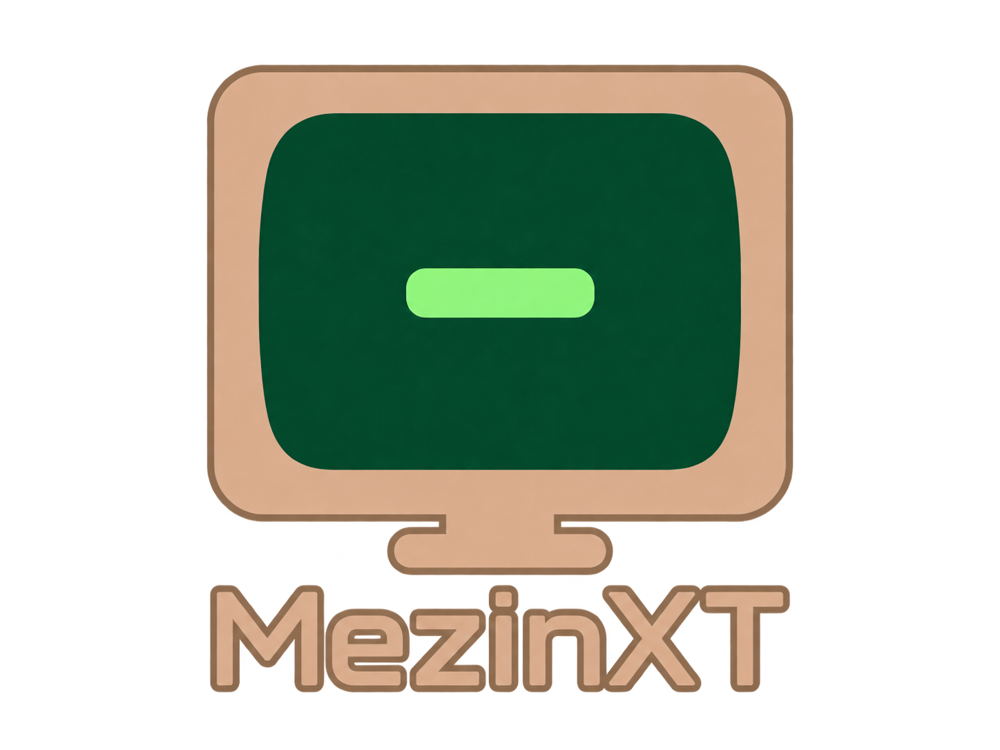
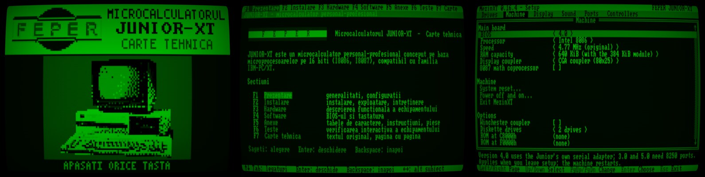

# MezinXT

[Română](README.ro.md)

<p align="center"></p>

An emulator of the FEPER JUNIOR-XT, the Romanian PC/XT compatible of 1989 (8086 at 4.77 MHz,
CGA, XT keyboard, 5.25" floppy drives, Z80-SIO serial adapter), built chip by chip to run the
machine's original firmware. It is built for Windows and Linux, on x64 and ARM64; the ARM64 builds have not
been tried on real ARM hardware (see the [limitations](docs/NOTES.md#limitations)).



## The Junior

The JUNIOR-XT was a microcomputer made by FEPER in Romania in 1989: an 8086 at 4.77 MHz, 256 or
640 KiB of RAM, a CGA display adapter, a PC speaker, an 83-key XT keyboard, one to four 5.25"
diskette drives, a serial adapter with two Z80-SIO channels and a parallel printer port, and eight
PC/XT expansion slots. Its catalogue also offered a Winchester disk coupler, a joystick coupler, a
monochrome display coupler, a 384 KiB memory module and an 8087 math processor.

MezinXT emulates the processor, the chips of the main board and the boards of that catalogue, and
runs the Junior's own BIOS unmodified: disks go through the diskette controller and the DMA chip,
keys through the keyboard interface, nothing is patched or trapped. The
[limitations](docs/NOTES.md#limitations) say what is not emulated.

## Quick start

1. Extract the archive: `MezinXT-<version>-windows-x64.zip` or `-windows-arm64.zip`, or
   `MezinXT-<version>-linux-x64.tar.gz` or `-linux-arm64.tar.gz`.
2. Run `mezinxt.exe` (Windows) or `./mezinxt` (Linux) from the extracted folder.

The folder holds the program, `roms/` (the Junior's four BIOS versions and its character ROM),
`disks/manual.img` and a `mezinxt.yaml` that puts the manual disk in drive A and shows the picture on
a green monochrome monitor with the CRT look. The machine runs its BIOS test and boots the manual disk:
the Junior's technical manual as an application that runs on the Junior itself, without an operating
system. It shows the manual as topics with links and drawings, the printed pages, and tests of the
keyboard, the display, the system and the diskette. It is in Romanian;
the [notes](docs/NOTES.md#the-manual-disk) describe it.

To run DOS and its programs, put your own DOS diskette images in `disks/`, insert one in drive A on the
setup screen (F12) or drop the file on the window, and restart the machine (Ctrl+F12). The colour
monitors are on the setup screen's Display page (`video.monitor`).

On Linux the program needs a 64-bit system with glibc 2.34 or later, and the libraries of the desktop
SDL talks to: X11 or Wayland, OpenGL or OpenGL ES, and ALSA or PulseAudio for sound.

## Keys

| Key | |
|---|---|
| F12 | The setup screen: drives, machine, display, sound, ports, controllers |
| Alt+Enter | Full screen |
| F11 | Give the keyboard joystick's keys to the computer, and back |
| Shift+F12 | Exit MezinXT at once: the disk images are written back and the setup screen's changes saved |
| Ctrl+F12 | Switch the machine off and on |
| Alt+F12 | Reset the machine |
| Pause | Stop and start the machine |
| Print Screen | Save `mezinxt-NNNN.png` |
| Ctrl+Pause | Ctrl-Break |
| Ctrl+Alt+End | Ctrl-Alt-Del |
| Ctrl+F10 | Let go of the captured serial mouse |

Every other key is the key of the 83-key XT keyboard in the same place; the cursor block, Home, End,
Insert, Delete, Page Up and Page Down are the keypad keys that carry them on the XT. A disk image
dropped on the window goes into drive A (drive B with Shift held). Lights for the drives at work (not
original) are shown in the picture's bottom row with `video.drive_lights`. The CGA card shows snow in
80-column text while a program uses the video store, as the real card does; `video.snow: false` (or the
setup screen's Display page) turns it off (not original).

## The setup screen

F12 opens a text-mode setup screen in the manner of late-1980s DOS utilities, drawn with the Junior's
own character ROM. Left and Right turn the pages, Up and Down select an option, Page Up and Page Down
change its value, Enter opens or switches it and Esc leaves. A game controller works too: the d-pad
moves (left and right turn the pages), the shoulder buttons change the value, A is Enter, B is Esc and
Start opens and closes the screen. The pages are Drives (insert, eject, protect, fast access, make a blank
disk), Machine (BIOS, processor, speed, memory, boards, and Exit MezinXT, which closes the program at once as
Shift+F12 does), Display, Sound, Ports and Controllers. A change is
written to `mezinxt.yaml`: display and language changes apply at once, disks when they are inserted,
ports and sound on leaving the screen, and a change to the machine's own settings resets the machine
on leaving.

## Languages

The setup screen and the messages in the window are in English or Romanian: `ui.language` in
`mezinxt.yaml` (`en` or `ro`), or the Language item of the Display page, which applies at once. A first
start picks Romanian on a system whose user language is Romanian. This README is also available in
[Romanian](README.ro.md).

## Disks and ROMs

Disk images are raw sector dumps of 160, 180, 320, 360 or 720 KiB (the Junior's own format is 320 KiB,
40 tracks, two sides, eight sectors). Name them in the `drives` section of `mezinxt.yaml`, choose them on
the setup screen's Drives page (its file picker opens in `disks/` beside the configuration) or drop them
on the window. Changes the guest makes are written back to the image file, so keep a copy of a disk you
care about. The setup screen can also make blank disks, and blank fixed disks of 20 to 70 MB.

The drives are heard as the real ones were: the diskette motor's whirr, the stepper's click on every
track step, the head load's tock, and a fixed disk's whine, the chirp and click of its seeks and the buzz of its long ones. The sounds
are made up from what the drives do (nothing is recorded; the fixed disk is modelled on measurements of a 1987 Miniscribe 8425), mixed with the speaker's, and can be switched off or turned
down on the Sound page (`sound.drives`, `sound.drives_volume`). With Fast access on for a drive (the
Drives page, `drives.a.fast` to `drives.hd1.fast`), the machine runs faster than real time while that drive works, so loading
is quick, and the drives are then heard at the pace of the clock, with as many clicks as there were steps.

The ROMs are `roms/bios-3.0.rom`, `bios-4.0.rom`, `bios-5.0.rom`, `bios-5.0-alt.rom` and `chargen.rom`
(the character ROM). MezinXT looks for them in `roms/` in the working folder, beside the configuration
and beside the program, and recognises them by their content, whatever their names;
`mezinxt --list-roms` shows what it found. The BIOS version is `machine.bios` (4.0, the default, is the
one that matches the Junior's own serial adapter).

Without the ROMs a test screen in the Junior's own character set says which are missing.

## Options of the machine

The setup screen (F12) and `mezinxt.yaml` offer the boards and options of the Junior's catalogue;
the [notes](docs/NOTES.md#configuration) list every key.

- Memory of 64, 128, 192 or 256 KiB (the board's banks), or 640 KiB with the 384 KiB module; the
  module's EPROM sockets take an option ROM image at C8000h, F0000h or F8000h (`machine.rom_*`).
- One to four diskette drives (`machine.drives`), each of 40 or 80 tracks (`drives.a.tracks`); an
  80-track drive reads 720 KiB disk images. DOS names only the first two; the others are reached
  through the BIOS.
- The game control adapter (joystick coupler, `controllers.adapter`) with two joysticks, each fed by a
  host game controller (its stick or d-pad, A and B as the buttons) or by the keyboard: the arrow keys
  and Left Ctrl and Left Shift as the two buttons (the setup screen's Controllers page, Joystick keys,
  or `controllers.keys` chooses others), which then no longer reach the DOS program until F11 gives them
  back to the computer (and again).
- A light pen on the CGA (`controllers.light_pen`): the mouse over the picture, its left button the
  pen's switch.
- The monochrome display coupler (`machine.display: mda`) in place of the CGA: 80x25 text in 9x14 cells
  on a green-phosphor monitor, with its own printer port (`ports.lpt_mda`, the first printer the BIOS
  finds).
- The PC/XT asynchronous adapter (`ports.pc_serial`: `one` or `two` ports), 8250 serial ports COM1 and
  COM2 that BIOS 3.0 and 5.0 list; BIOS 4.0 uses the Junior's own serial adapter instead. Both drive
  IRQ 4, so the 8250 ports need `ports.adapter: false`. Each port (`ports.com1`, `ports.com2`) takes the
  same ends as the Junior's serial channels, or `mouse`: the host mouse as a Microsoft serial mouse, for
  a DOS mouse driver on that port. The setup screen's Controllers page sets it (Mouse: COM1 or COM2),
  which fits the PC/XT adapter and takes the Junior's own serial and printer adapter out. A click on
  the picture captures the mouse (the pointer is hidden); Ctrl+F10 lets it go, and so do the setup
  screen, Pause and losing the keyboard.
- The Winchester coupler (`machine.winchester`) with one or two fixed disks (`drives.hd0.image`,
  `drives.hd1.image`): raw disk images of 17-sector tracks, such as 20 MB (615 cylinders, 4 heads) up
  to 70 MB, which DOS's FDISK and FORMAT prepare. The machine boots from the diskette in A: when there
  is one, else from the fixed disk.
- The serial channels and the printer port reach the host through the `ports` section: a loopback plug,
  a host serial port, a TCP connection or server, a pipe, or a file (the printer's output).
- An 8087 math processor (`machine.fpu`).
- The processor can be an 8086 or an 8088, at the original 4.77 MHz or at the non-original 7.16 MHz,
  9.54 MHz or unthrottled (`machine.cpu`, `machine.speed`).

## Documentation

- [Notes](docs/NOTES.md): the manual disk, every setting of `mezinxt.yaml`, and the limitations; the manual disk's notes
  are also in [Romanian](docs/NOTES.ro.md).
- [Changelog](docs/CHANGELOG.md): what each version changed.
- [Third-party components](docs/THIRD_PARTY.md), with the notices of the ROMs and libyaml.

## Building from source

On Windows you need Visual Studio 2022 or later with the C++ tools, CMake 3.24 or later, Ninja and
Python 3. SDL is downloaded during the first build.

```
pwsh -File tools/build.ps1
python tools/fetch_roms.py
python tests/verify.py
```

builds `build/x64/mezinxt.exe`, runs the tests, fetches the ROMs (FEPER's, not part of the source) into `roms/` and runs
the headless checks. `pwsh -File tools/build.ps1 -Arch arm64` builds for Windows on ARM when the Visual Studio ARM64 C++
tools are installed. `pwsh -File tools/build_dist.ps1` makes the release archive in `dist/releases/`.

On Linux (Debian 12, WSL included), `tools/build_linux.sh` builds, tests and packages the x64
and ARM64 programs; its header lists the packages it needs.

## License

GPL-3.0-or-later (`docs/LICENSE`). Third-party components are listed in `docs/THIRD_PARTY.md`.
