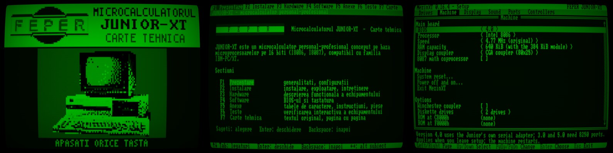

# MezinXT

[English](README.md)

<p align="center"></p>

Emulator al microcalculatorului FEPER JUNIOR-XT, calculatorul românesc compatibil PC/XT din
1989 (microprocesor 8086 la 4,77 MHz, cuplor de afișaj CGA, tastatură XT, unități de
dischetă de 5,25 inch, cuplor serial Z80-SIO), construit circuit cu circuit pentru a rula
programul original al microcalculatorului (BIOS). Se compilează pentru Windows și pentru Linux,
pe x64 și pe ARM64; variantele ARM64 nu au fost încercate pe echipament ARM real (vezi
[limitările](docs/NOTES.md#limitations), în engleză).



## Microcalculatorul Junior

JUNIOR-XT a fost un microcalculator fabricat de FEPER în România în 1989: microprocesor 8086 la
4,77 MHz, memorie RAM de 256 sau 640 Kocteți, cuplor de afișaj CGA, difuzor, tastatură XT cu 83
de taste, de la una la patru unități de dischetă de 5,25 inch, un cuplor cu două canale
seriale Z80-SIO și o interfață paralelă pentru imprimantă, precum și opt conectoare de extensie
PC/XT. Catalogul lui mai cuprindea un cuplor de disc fix (Winchester), un cuplor pentru Joystick,
un cuplor pentru afișaj monocrom, un modul de memorie de 384 Kocteți și un coprocesor matematic
I8087.

MezinXT emulează microprocesorul, circuitele plăcii logice de bază și cuploarele din acest
catalog și rulează BIOS-ul original al Junior nemodificat: dischetele trec prin controlorul de
dischetă și prin circuitul DMA, tastele prin interfața tastaturii, nimic nu este modificat
sau interceptat. [Limitările](docs/NOTES.md#limitations) (în engleză) arată ce nu este
emulat.

## Pornire rapidă

1. Se extrage arhiva: `MezinXT-<versiune>-windows-x64.zip` sau `-windows-arm64.zip`, ori
   `MezinXT-<versiune>-linux-x64.tar.gz` sau `-linux-arm64.tar.gz`.
2. Se rulează `mezinxt.exe` (Windows) sau `./mezinxt` (Linux) din folderul extras.

Folderul conține programul, `roms/` (cele patru versiuni de BIOS ale Junior și memoria ROM de
caractere), `disks/manual.img` și un `mezinxt.yaml` care pune discheta cu cartea tehnică în unitatea A
și arată imaginea pe un monitor monocrom verde, cu aspectul CRT. Microcalculatorul execută testul BIOS
și pornește de pe dischetă: cartea tehnică a microcalculatorului Junior sub forma unui program care
rulează chiar pe Junior, fără sistem de operare. Prezintă cartea tehnică pe subiecte cu legături și
desene, paginile tipărite și verificări ale tastaturii, afișajului, sistemului și dischetei;
[notele](docs/NOTES.ro.md#discheta-cu-cartea-tehnică) o descriu.

Pentru DOS și programele lui se pun propriile imagini de dischete DOS în `disks/`, se introduce una în
unitatea A din ecranul de configurare (F12) sau trăgând fișierul peste fereastră și se reinițializează
microcalculatorul (Ctrl+F12). Monitoarele color se aleg pe pagina Afișaj a ecranului de configurare
(`video.monitor`).

Pe Linux sunt necesare un sistem pe 64 de biți cu glibc 2.34 sau mai nou și bibliotecile cu care
lucrează SDL: X11 sau Wayland, OpenGL sau OpenGL ES și, pentru sunet, ALSA sau PulseAudio.

## Taste

| Tasta | |
|---|---|
| F12 | Ecranul de configurare: unități de dischetă, microcalculator, ecran, sunet, interfețe, joystick |
| Alt+Enter | Ecran complet |
| F11 | Tastele joystick-ului de pe tastatură: la microcalculator și înapoi |
| Shift+F12 | Ieșire imediată din MezinXT: imaginile se scriu înapoi, iar modificările din ecranul de configurare se salvează |
| Ctrl+F12 | Oprirea și pornirea microcalculatorului |
| Alt+F12 | Reinițializarea microcalculatorului |
| Pause | Oprirea și reluarea funcționării |
| Print Screen | Salvarea ecranului în `mezinxt-NNNN.png` |
| Ctrl+Pause | Ctrl-Break |
| Ctrl+Alt+End | Ctrl-Alt-Del |
| Ctrl+F10 | Eliberarea mouse-ului serial captat |

Celelalte taste sunt tastele tastaturii XT cu 83 de taste, în același loc; blocul de cursor,
Home, End, Insert, Delete, Page Up și Page Down sunt tastele de pe tastatura numerică care le
poartă pe XT. O imagine de dischetă trasă peste fereastră intră în unitatea A (în unitatea B
cu Shift apăsat). Indicatoarele unităților în funcțiune (nu există la original) apar în rândul de
jos al imaginii cu `video.drive_lights`. Cuplorul CGA produce paraziți (zăpadă) în textul pe 80 de
coloane cât timp un program folosește memoria de ecran, ca cuplorul real; `video.snow: false` (sau
pagina Ecran a ecranului de configurare) îi oprește (nu există la original).

## Ecranul de configurare

F12 deschide un ecran de configurare în mod text, în maniera programelor utilitare DOS de la
sfârșitul anilor 1980, desenat cu memoria ROM de caractere a Junior. Tastele Stânga și Dreapta
schimbă pagina, Sus și Jos selectează o opțiune, Page Up și Page Down îi schimbă valoarea, Enter
o deschide sau o comută, iar Esc părăsește ecranul. Un dispozitiv de intrare de tip joystick
(gamepad) funcționează la fel: săgețile se deplasează (stânga și dreapta schimbă pagina),
butoanele de umăr schimbă valoarea, A este Enter, B este Esc, iar Start deschide și închide
ecranul. Paginile sunt Unități (introducere, scoatere, protecție, acces rapid, dischetă nouă goală),
Microcalculator (BIOS, microprocesor, frecvență, memorie, cuploare și Ieșire din MezinXT, care închide
programul imediat, ca Shift+F12), Ecran, Sunet, Interfețe și Joystick. Modificările se scriu în `mezinxt.yaml`: cele de ecran și de limbă se aplică imediat,
dischetele la introducere, interfețele și sunetul la ieșirea din ecran, iar o modificare a
opțiunilor microcalculatorului îl reinițializează la ieșire.

## Limba

Ecranul de configurare și mesajele din fereastră sunt în engleză sau în română: `ui.language`
din `mezinxt.yaml` (`en` sau `ro`) sau rubrica Limba/Language din pagina Ecran, care se
aplică imediat. La prima pornire se alege româna pe un sistem a cărui limbă de utilizator este
româna.

## Discuri și memorii ROM

Imaginile de dischetă sunt copii brute ale sectoarelor, de 160, 180, 320, 360 sau 720 Kocteți
(formatul propriu al Junior este de 320 Kocteți, 40 de piste, dublă față, opt sectoare). Se
indică în secțiunea `drives` din `mezinxt.yaml`, se aleg în pagina Unități a ecranului
de configurare (selectorul de fișiere se deschide în `disks/`, lângă configurație) sau se trag
peste fereastră. Modificările făcute de programe se scriu înapoi în fișierul imagine, deci este
bine să se păstreze o copie a imaginii care contează. Ecranul de configurare poate crea și
dischete goale, precum și discuri fixe goale de la 20 la 70 MB.

Unitățile se aud ca cele adevărate: huruitul motorului dischetei, clicul motorului pas cu pas la
fiecare deplasare a capului, „toc”-ul coborârii capului, iar discul fix are un zumzet grav de rotație și,
la deplasări, un huruit urmat de un „toc” înfundat. Sunetele sunt imitate după ce fac unitățile (nu sunt înregistrări), se
amestecă cu al difuzorului și se opresc sau se reduc în pagina Sunet (`sound.drives`,
`sound.drives_volume`). Cu Acces rapid pornit pentru o unitate (pagina Unități,
`drives.a.fast` până la `drives.hd1.fast`), microcalculatorul merge mai repede decât în timp real cât lucrează unitatea, deci
încărcarea este rapidă, iar unitățile se aud atunci în ritmul ceasului, cu atâtea clicuri câți pași
s-au făcut.

Memoriile ROM sunt `roms/bios-3.0.rom`, `bios-4.0.rom`, `bios-5.0.rom`, `bios-5.0-alt.rom` și
`chargen.rom` (memoria ROM de caractere). MezinXT le caută în `roms/` din folderul de lucru, lângă
configurație și lângă program și le recunoaște după conținut, indiferent de nume; `mezinxt
--list-roms` arată ce a găsit. Versiunea de BIOS este `machine.bios` (4.0, cea implicită, este
cea care se potrivește cu cuplorul serial propriu al Junior).

Fără memoriile ROM, un ecran de probă în setul de caractere propriu al Junior arată care lipsesc.

## Opțiunile microcalculatorului

Ecranul de configurare (F12) și `mezinxt.yaml` oferă cuploarele și opțiunile din catalogul
Junior; [notele](docs/NOTES.md#configuration) (în engleză) enumeră toate cheile.

- Memorie de 64, 128, 192 sau 256 Kocteți (băncile plăcii) sau de 640 Kocteți cu modulul de
  384 Kocteți; soclurile EPROM ale modulului primesc o imagine ROM de opțiune la C8000h, F0000h
  sau F8000h (`machine.rom_*`).
- De la una la patru unități de dischetă (`machine.drives`), fiecare cu 40 sau 80 de piste
  (`drives.a.tracks`); o unitate cu 80 de piste citește imagini de 720 Kocteți. DOS le numește
  numai pe primele două; celelalte se folosesc prin BIOS.
- Cuplorul pentru Joystick (`controllers.adapter`) cu două joystick-uri, fiecare comandat de un
  dispozitiv de intrare al gazdei (joystick-ul sau săgețile lui, A și B ca butoane) sau de
  tastatură: tastele cursor și Ctrl și Shift din stânga ca cele două butoane (pagina Joystick a
  ecranului de configurare, Taste de joystick, sau `controllers.keys` stabilește altele), care nu mai
  ajung atunci la programul DOS până când F11 le dă înapoi microcalculatorului (și din nou).
- Un creion optic la cuplorul CGA (`controllers.light_pen`): mouse-ul aflat pe ecran, cu
  butonul stâng drept comutator al creionului.
- Cuplorul pentru afișaj monocrom (`machine.display: mda`), în locul cuplorului CGA: text 80x25
  în celule de 9x14 puncte, pe un monitor cu fosfor verde, cu interfață paralelă proprie
  (`ports.lpt_mda`, prima imprimantă găsită de BIOS).
- Cuplorul serial asincron PC/XT (`ports.pc_serial`: `one` sau `two` interfețe), interfețele
  seriale 8250 COM1 și COM2 pe care le găsesc BIOS 3.0 și 5.0; BIOS 4.0 folosește în loc
  cuplorul serial propriu al Junior. Ambele folosesc IRQ 4, deci interfețele 8250 cer
  `ports.adapter: false`. Fiecare interfață (`ports.com1`, `ports.com2`) primește aceleași
  capete ca canalele seriale ale Junior sau `mouse`: mouse-ul gazdei ca mouse serial Microsoft,
  pentru un driver de mouse DOS de pe interfața respectivă. Pagina Joystick a ecranului de
  configurare îl stabilește (Mouse: COM1 sau COM2): instalează cuplorul serial PC/XT și scoate
  cuplorul serial și imprimanta proprii ale Junior-ului. Un clic pe ecran captează mouse-ul
  (indicatorul este ascuns); Ctrl+F10 îl eliberează, la fel ecranul de configurare, Pause și
  pierderea tastaturii.
- Cuplorul de disc fix (Winchester, `machine.winchester`) cu unul sau două discuri fixe
  (`drives.hd0.image`, `drives.hd1.image`): imagini brute de disc cu piste de 17 sectoare, de
  la 20 MB (615 cilindri, 4 capete) până la 70 MB, pe care FDISK și FORMAT din DOS le pregătesc.
  Microcalculatorul pornește de pe discheta din unitatea A: când există una, altfel de pe
  discul fix.
- Canalele seriale și interfața paralelă ajung la calculatorul gazdă prin secțiunea `ports`: o
  buclă de test, o interfață serială a gazdei, o conexiune sau un server TCP, un pipe sau un
  fișier (ieșirea imprimantei).
- Un coprocesor matematic I8087 (`machine.fpu`).
- Microprocesorul poate fi I8086 sau I8088, la frecvența originală de 4,77 MHz sau la cele
  care nu există la original, de 7,16 MHz, 9,54 MHz ori nelimitată (`machine.cpu`, `machine.speed`).

## Documentație

- [Note](docs/NOTES.ro.md): discheta cu cartea tehnică; toate cheile din `mezinxt.yaml` și limitările sunt în
  [notele în engleză](docs/NOTES.md).
- [Istoricul versiunilor](docs/CHANGELOG.md) (în engleză).
- [Componente terțe](docs/THIRD_PARTY.md) (în engleză), cu notele despre memoriile ROM și libyaml.

## Compilare din sursă

Pe Windows sunt necesare Visual Studio 2022 sau mai nou cu uneltele C++, CMake 3.24 sau mai
nou, Ninja și Python 3. SDL se descarcă la prima compilare.

```
pwsh -File tools/build.ps1
python tools/fetch_roms.py
python tests/verify.py
```

compilează `build/x64/mezinxt.exe`, rulează testele, aduce memoriile ROM (ale FEPER, nu fac parte din sursă) în `roms/`
și rulează verificările fără fereastră. `pwsh -File tools/build.ps1 -Arch arm64` compilează pentru Windows pe ARM când
sunt instalate uneltele C++ ARM64 din Visual Studio. `pwsh -File tools/build_dist.ps1` face arhiva de distribuție în
`dist/releases/`.

Pe Linux (Debian 12, inclusiv în WSL), `tools/build_linux.sh` compilează, testează și
împachetează programele x64 și ARM64; începutul lui enumeră pachetele necesare.

## Licență

GPL-3.0-or-later (`LICENSE`). Componentele terțe sunt enumerate în
`docs/THIRD_PARTY.md`.
